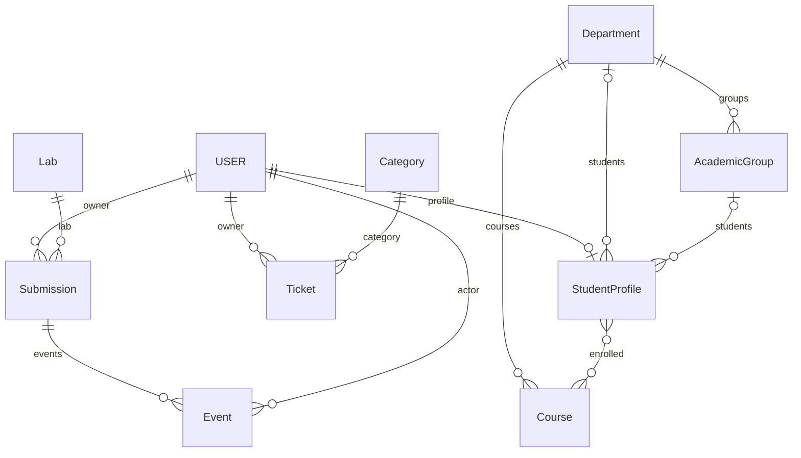

# Модели и связи базы данных

| Сущность | Основные поля | Связи |
|---|---|---|
| `auth.User` | `id`, `username`, `password`, `is_staff` | Встроенная модель Django |
| `Department` | `id`, `name` | Курсы, группы, профили |
| `Course` | `id`, `title`, `department_id` | FK Department; M2M StudentProfile |
| `AcademicGroup` | `id`, `name`, `department_id` | FK Department |
| `StudentProfile` | `id`, `user_id`, `department_id`, `academic_group_id` | OneToOne User; FK Department/AcademicGroup; M2M Course |
| `Category` | `id`, `name` (уникальное) | FK в Ticket |
| `Ticket` | `id`, `title`, `description`, `category_id`, `owner_id`, `status`, `created_at` | FK Category и User |
| `Lab` | `id`, `title`, `free_slots` | FK в Submission |
| `Submission` | `id`, `lab_id`, `owner_id`, `comment`, `status`, `created_at` | FK Lab и User |
| `Event` | `id`, `submission_id`, `user_id`, `action`, `created_at` | FK Submission и User |

Статусы Ticket: `new`, `progress`, `done`. Статусы Submission: `new`, `booked`, `accepted`. При удалении Category/Lab связи защищены `PROTECT`; остальные правила удаления смотрите в `models.py`. Диаграмма показывает основные предметные сущности; служебные таблицы Django (сессии, права, миграции) не изображены.
